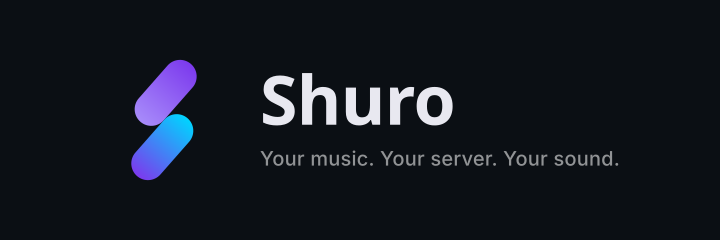

<p align="center">
  
</p>

<p align="center">
  
  
  
  
  
</p>

> **Own your music. Stream it at full quality. Let it surprise you.**

**Shuro** is a fast, dark, cinematic music player for people who run their own
server. It speaks the **Subsonic / OpenSubsonic API** — built for
**Navidrome** and every compatible server — and plays your **local files**
with real ID3v2 / FLAC tag support. One library, every source, every screen.

No accounts. No telemetry. No transcoding unless you ask for it.

---

## ✨ The showcase

### 🖤 A Now Playing screen that feels alive

- **Adaptive artwork backdrop** — a slow-breathing mesh gradient generated
  from each track's own palette, with the cover blurred into it. Tune the
  blur, pick the motion speed (Normal · Subtle · Lively), or switch it off.
- **Karaoke lyrics** — word-by-word fill or line-by-line highlight. Sources:
  your files' embedded OpenSubsonic tags, embedded LRC, and **LRCLIB** (exact
  match → search → best-candidate scoring, with ±2 s duration tolerance).
  Honors the `[offset:±ms]` tag, `[AU: instrumental]` markers, and real
  enhanced-LRC word timestamps. Tap a line to seek; nudge sync ±0.5 s.
- **A positional cue, not just bold** — the sung line carries an accent
  caret (left-aligned) or underline (centred), with a 78 % / 60 % contrast
  ladder — repeated lines ("oh oh oh") are unambiguous.
- **Reading mode** — scroll up into earlier lines and auto-follow steps aside
  completely; a Resume chip brings it back. Tapping a line seeks *and*
  re-follows.
- **Scrubbing artwork ring** — the progress bar *is* the artwork: a glowing
  knob marks the position, grows while you drag, previews the target, and
  commits **one seek on release**.
- **Split-screen landscape & two-pane wide** — player left, live lyrics
  right on phones; a true two-pane layout ≥1024 dp.
- **Audio Info that tells the truth** — file codec/bit depth/sample
  rate/channels/bitrate (with provenance), the request actually made
  (original vs capped), effects applied, the classified output route, the
  platform's direct-playback answer with mode, and the **output device's
  accepted sample rates, channel counts and PCM encodings**. A live stream
  probe shows what the server *actually sends* vs what you asked for.
  Unknowns read "not reported" — never a guess, never a "bit-perfect" claim.
- **Sleep timer suite** — 15/30/45/60/90 presets, a custom clock picker
  (*"pause at 12:17"*), *End of track*, *End of queue*, 0–60 s fade-out,
  +10 min extend, live countdown, cancel-safe generation guard.
- **Volume sheet** — system media volume with an honest player-volume
  fallback (web), drag pill with % bubble, mute that restores pre-mute,
  haptics at 0/100 %.

### 🖥️ Multi-server, one library

Several servers **merge into one collection**: songs, albums, artists,
genres and playlists side by side, deduplicated (title+artist+duration
identity, first server wins), with per-server enable switches in Settings
and **per-song routing** that streams from whichever server owns the track —
even mid-queue. Servers connect in parallel with per-server timeouts, and a
dead server never takes the library down.

### 🧠 Shuro Pulse — recommendations that rotate, not repeat

| Signal | What it does |
|---|---|
| 🕐 Session rotation | Every launch re-seeds every list — fresh mix, stable while you listen |
| 📈 Recency decay | Recently heard tracks sink; unheard ones rise |
| 🎨 Genre-affinity graph | Genres score by the taste of the songs living in them |
| ❤️ Feedback loop | More-like / Less-like / Not-interested on recommendations feed artist affinity |
| 🌙 Time-of-day | Late night leans mellow, evening leans energy |
| 🎭 Diversity cap | Max 2 tracks per artist until everyone had a turn |
| 🧭 Anti-echo | Because-You-Like favours under-listened artists near your taste |

Rows are **memoized per library signature + hour** (no frame jank) and
**guaranteed their length** — small and single-artist libraries fill too.

**Discover:** For You · Tonight's Flow (24-track generated session) ·
Because You Like <artist> · Rediscover · Deep Cuts · Fresh From Your
Library.

### 🪄 Ask for a mood, get a mix

- **Build with Shuro** — *"something calm for studying"*, *"high energy for
  the gym"* → a ranked 20-track queue; artist mentions narrow it.
- **Build from this** — every song is a seed: Similar · Same era · Deeper
  cuts · Surprise me · Smooth continuation (duration-budgeted).
- **10 Smart Playlists** — Rediscover, Deep Cuts, Late Night, Favorites Mix,
  Recently Added, Forgotten Favorites, High Energy, Chill, Focus, Long
  Drive. Re-evaluated live, never a stale stored list.
- **Feedback buttons** on recommendations (More like / Less like) feed the
  affinity graph.

### 🔀 Shuffle that means what it says

On: shuffles what's ahead, pins the playing track first, re-lays the native
window so **"Up next" is exactly what plays**. Off: restores the saved order
when it still contains the playing track. Queue integrity is enforced by the
chaos harness.

### 📥 Real offline. Real tags. Real quality.

- Original `format=raw` bytes downloaded to storage that survives app
  updates (or any folder you pick), real byte progress, cancel with file
  cleanup, Wi-Fi-only guard.
- Download-preferred playback automatically; cache-first library works in
  airplane mode.
- **Local files are first-class**: recursive folder import, pure-Dart
  ID3v2.2/2.3/2.4 + FLAC Vorbis parsing (title/artist/album/genre/artwork),
  "Artist - Title" filename fallback, palette extraction — same pipeline as
  server tracks.

### 🔊 Serious playback engineering

- **Windowed native queue**: 12 before / 15 after the playhead (whole queue
  ≤60), inserted and removed in place — instant starts, gapless hand-off,
  no reloads. Full lock-screen / Bluetooth / **Android Auto** controls.
- Play next · add to queue · reorder · remove · clear · shuffle · **restore
  queue + position across launches** · autoplay suggestions past the end.
- Fade between songs (2/4/6 s), speed 0.75×–2×, skip silence, ReplayGain
  from your server's tags.
- **Scrobbles that count** — now-playing ping, Last.fm's documented rule
  (submit at 50 % or 4 min, skip ≤30 s), corrected timestamps, ordered
  persistent queue (cap 500, batches ≤50) with error-aware retry/re-auth,
  plus Navidrome play reporting. Optional "send loves to Last.fm".
- **Wrong-song self-heal** — if engine and app ever disagree about the
  track, Shuro detects and resyncs, and logs it.
- Stream probe verifies what the server actually sends (206 range support,
  served format vs tagged format).

### 🎚️ Honest audio reporting

- Quality tiers: **Original** (`format=raw`, never silently downgraded) or
  explicit High/Medium/Low caps — with a request-vs-served check that flags
  transcodes.
- Output path: classified route, **direct-playback support and mode**
  (offload/bitstream, API 33+), the output device's accepted **sample rates,
  channel counts and PCM encodings**, hi-res-PCM and USB status as
  requested/accepted.
- Never claims "bit-perfect": Shuro reports what the platform answers.

### 🖥️ Desktop edition — Windows & Linux

Shuro has native Flutter desktop targets for **Windows and Linux**. The desktop shell is
built for keyboard-and-pointer use while reusing the same library, queue, and player
state as the mobile experience. **macOS is not a supported build target yet**: this
repository does not currently include a `macos/` runner or macOS CI job.

- **Desktop workspace** — navigation sidebar, main content pane, persistent
  now-playing bar, and an optional lyrics inspector on wide windows.
- **Desktop playback** — `libmpv` through `just_audio_media_kit`; the desktop
  frontend continues to use Shuro's shared player controller and queue logic.
- **Keyboard controls** — `Space` toggles play/pause, `Ctrl+←/→` changes tracks,
  `Ctrl+1…5` switches Home/Library/Search/Discover/Favorites, `Ctrl+K` opens
  Search, and `Ctrl+L` toggles the lyrics view. Typing in text fields takes priority.
- **Tray-aware close behavior** — when a system-tray host is available, closing the
  window hides Shuro so playback can continue; the tray menu offers Show, Hide, and
  Quit. On Linux desktops without a tray host, closing behaves normally.
- **Build locally** — run `flutter build windows --release` on a Windows build
  machine or `flutter build linux --release` on a Linux machine. CI also validates
  both desktop builds; tagged releases package a Windows installer and Linux
  `.deb` when the release workflow succeeds.

**Desktop implementation references:** [Desktop layout and interaction design](docs/desktop-design.md) ·
[Desktop shell](lib/widgets/desktop_shell.dart) ·
[Desktop lifecycle and tray behavior](lib/services/desktop_lifecycle.dart) ·
[Playback audit](docs/playback-audit.md) ·
[Performance report](docs/perf-report.md).

> **Screenshots:** This repository does not yet include captures of the running
> Windows/Linux desktop UI. The links above are design and implementation references,
> not claims of a screenshot-verified visual review. Add real screenshots once
> captured on each supported desktop platform.

---

### 📐 Adaptive to every window

- **Navigation rail in every landscape window** (from 400 dp wide) and on
  portrait tablets/foldables from 720 dp; bottom bar only on portrait
  phones.
- Rail width scales **86 / 104 / 116 dp**; below **420 dp tall** it goes
  icon-only, hides the logo and scrolls — no overflow stripes at any size.
- Tab state survives the rail↔bar switch; sheets are height-bounded and
  scroll; rows wrap instead of overflowing; song rails follow the user's
  **text scale**.
- **Desktop shell** (Windows/Linux): sidebar navigation, a persistent
  now-playing bar with preview-then-commit seeking and volume, a lyrics
  side panel, and keyboard shortcuts (Space, Ctrl+←/→, Ctrl+1–5, Ctrl+L).
  Playback uses the bundled **libmpv** backend; closing the window keeps the
  queue playing from the system tray, with an explicit **Quit Shuro** action.
  On Linux shells without a tray host, close behaves normally so the window
  can never be hidden without a way back.

### 🔒 Privacy that isn't a promise, it's a design

- First-launch **consent screen** listing exactly what leaves the device.
- **Zero telemetry**: no analytics SDK, no crash uploader, no ads.
- Server passwords in **encrypted secure storage** (Android
  `encryptedSharedPreferences`; Linux uses libsecret).
- **Report a problem** exports a *redacted* event log (last 300 playback
  events; `u=`/`t=`/`s=`/`p=` params scrubbed; re-redacted on export) —
  copy or share, nothing sent on its own.
- Memory-pressure aware: caches drop on `onTrimMemory` so playback survives.

---

## 🖼️ The UI tour

| Screen | What you'll see |
|---|---|
| **Splash → Onboarding** | Animated brand launch, welcome with one-tap reconnects, consent, guided server setup (password visibility, per-row connect states) |
| **Home** | Greeting by time of day, search pill, Downloads + avatar, real pull-to-refresh, Pulse rails, recently played/added, favorites |
| **Library** | Songs (count, Play all, Shuffle, 3 sorts) · Albums · Artists (auto-resolved artwork) · Genres (gradient tiles) · Playlists (local + server) · Local — per-tab pull-to-refresh |
| **Album & Artist detail** | Discography and artist pages, per-item action sheets (shuffle, download, favourite, rating) |
| **Now Playing** | Breathing backdrop, karaoke lyrics with caret cue, scrubbing ring, ⋮ actions, quick actions (Queue · Sleep · Volume · Audio info) |
| **Lyrics** | Full-screen word-fill karaoke, sync nudge, tap-to-seek, reading mode, embedded compact preview |
| **Queue** | Now-playing row, reorderable Up-Next, per-row actions, Clear, Save-as-playlist |
| **Discover** | Six Pulse rows + Smart Playlists + Build with Shuro + feedback buttons |
| **Favorites** | Tabbed Songs / Albums / Artists |
| **Downloads** | Stats card, location picker, per-song remove/cancel, original-quality note |
| **Playlists** | Create with photo cover or auto-collage, rename/delete, server playlist management, save queue as playlist |
| **Search** | Live grouped results, recent-search chips |
| **Settings** | Servers, quality per network, **Equalizer**, crossfade/ReplayGain/speed/skip-silence, lyrics options, downloads, cache, appearance (fonts, artwork styles, motion, blur, immersive), behaviour (autoplay, resume), performance profile, rescan, reset, About with device facts, Report a problem, licences |

Dark-only by design. Skeletons for every loading state. Reduce-animations
honoured everywhere. Personalization: font family picker, artwork styles
(square/rounded/circle), blur + motion tuning, profile avatar editor
(pinch/pan/rotate crop), adaptive launcher icon, animated splash.

---

## ⚡ Built the hard way

- 🧪 **143 test cases across 12 suites**, including a **seeded chaos
  harness** (20 seeds × 2,000 random actions = **40,000 actions** with
  invariants asserted after every one — any failure reproduces from its
  seed), lyrics parser suite (39 tests: formats, offsets, word sync,
  instrumental, tolerance), scrobble/error-routing tests, capability-monitor
  tests, and layout tests from 320×568 to 1920×1080.
- 🩺 A **redacted event log** (300-event ring) + **Report a problem** export,
  so bug reports are evidence rather than vibes.
- ⏱️ Startup that **cannot hang**: every boot dependency has a hard timeout.
- 🩹 **Self-healing**: engine↔app desync detection, dead-source retry,
  stream-error surfacing, queue-state adoption after engine restart.
- 🧹 **Zero analyzer issues** (fatal-warning CI gate) across the whole repo.

Targets Android API 24+ on 3 GB RAM devices and up. Windows and Linux
desktop builds are produced by CI.

---

## 🚀 Getting started

1. **Connect** — your Navidrome / Subsonic URL + account (or local files
   only). Multiple servers welcome; credentials are stored encrypted.
2. **Listen** — tap any song. Portrait gives the ring and lyric preview;
   landscape splits player + lyrics.
3. **Make it yours** — quality tiers, fade, ReplayGain, speed, skip
   silence, equalizer, backdrop motion, fonts, artwork styles, downloads
   location, sleep defaults.

### Build from source

```bash
flutter pub get
flutter test --no-pub          # 143 cases + chaos suite
flutter build apk --release            # Android
flutter build appbundle --release      # Play upload
flutter build windows --release        # Windows (needs VS C++ + Developer Mode)
flutter build linux --release          # Linux (needs GTK3, libmpv and libayatana-appindicator3 dev packages)
```

### CI/CD

Pushes to `main` run analyze + the full test suite, then build **Android
(APK + AAB)**, **Windows** (InnoSetup installer) and **Linux (.deb package)**
artifacts. Signed Android releases and tagged publishes (`v<version>`)
require repository secrets — see the workflow and
`docs/audio-feature-review.md`.

---

## 🌐 Services Shuro talks to

- **Your Navidrome / Subsonic server** — your music, your credentials.
- **LRCLIB (lrclib.net)** — synced lyrics, only when you open the lyrics view.
- **MusicBrainz / Cover Art Archive** — artist pictures and metadata
  fallback, rate-limited and cached.
- **Last.fm** — optional scrobbling with your own account.

No account data leaves your server except the queries that power the feature
you triggered. Everything recommendation-related is computed on-device.

## 🗂️ Project structure

```
lib/
├── backend/          # Subsonic REST clients + catalog mapping
├── models/           # Song, Album, Artist, lyrics, download state…
├── playback/         # Engine contract, source policy, diagnostics, event log
├── screens/          # Home, Library, Search, Discover, Favorites,
│                     # Now Playing, Lyrics, Queue, Downloads, Settings…
├── services/         # Shuro Pulse, equalizer, downloads, lyrics, caching…
├── state/            # AppState (catalog/session), PlayerController,
│                     # AppearanceSettings, DeviceProfile…
├── theme/            # Dark theme, brand tokens, dynamic palette
└── widgets/          # Shared UI (player, nav, cards, sheets, skeletons)
```

## 📄 License & author

© **AsHfIEXE**. All rights reserved.

Open-source packages are listed in-app: **Settings → About → Open source
licenses**. External services are credited under **Settings → About →
Services & data sources**.

See [CHANGELOG.md](CHANGELOG.md) for release history,
[docs/playback-audit.md](docs/playback-audit.md) for the playback audit,
[docs/audio-feature-review.md](docs/audio-feature-review.md) for audio
decisions, and [docs/perf-report.md](docs/perf-report.md) for measured
performance.
